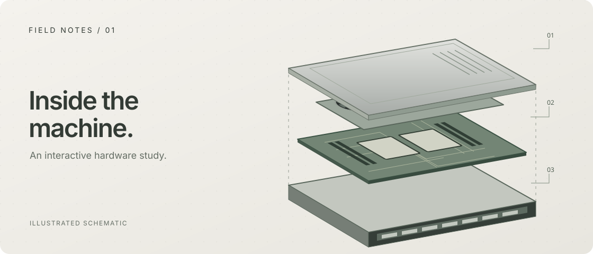

# Datacenter Autopsy

**A closer look at the machines behind modern computing.**

Explore the inside of five computers in interactive 3D, from a tiny Mac mini to an entire rack of AI hardware. Open them up, look around, and discover what each part does.

[**Explore the live experience →**](https://hark.site/s/df6ab919-ea91-4640-9b82-e25097bf47bf/index.html?hark_region=us)

[](https://hark.site/s/df6ab919-ea91-4640-9b82-e25097bf47bf/index.html?hark_region=us)

## What you can explore

| Machine | What makes it interesting |
| --- | --- |
| Apple Mac mini (M4 Pro) | A whole computer in a surprisingly small enclosure. |
| Dell PowerEdge R760 | A conventional server for everyday datacenter workloads. |
| Dell PowerEdge XE9680 | A server built around eight powerful AI accelerators. |
| NVIDIA DGX B200 | A dedicated system for training and running AI models. |
| NVIDIA GB200 NVL72 | An entire liquid-cooled rack that works as one large AI system. |

Choose a machine, drag to rotate it, and zoom in. Use the exploded-view slider to pull the hardware apart, click a component to learn what it does, or follow the guided teardown.

Everything runs in your browser. No account or API key is needed.

## Run locally

Requires Node.js 22 or later.

```sh
npm install
npm run dev
```

Open the local URL printed by Vite. To build for production, run `npm run build`.

## About the project

The 3D models are educational reconstructions based on publicly available hardware documentation. They approximate the real machines and are intended for exploration rather than physical repair.

Built with React, TypeScript and Three.js, using the MIT-licensed Bygga rendering engine.

[Hardware references](docs/hardware-references.md) · [Developer notes](docs/development.md) · [MIT license](LICENSE)
